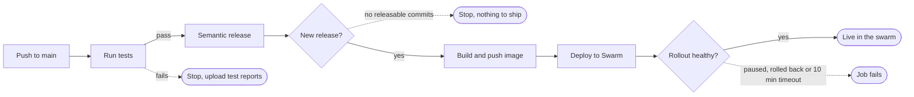
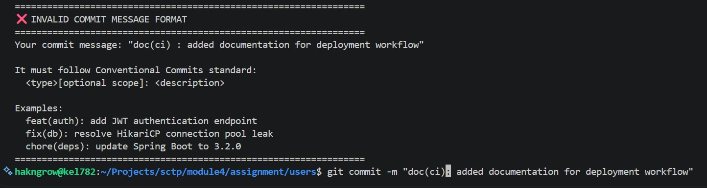

# User Service Deployment Workflow Walkthrough

## Overview

Every push to `main` runs four jobs in strict order: **test → release → build-and-push → deploy**. Each job runs only if the one before it succeeded, and the build and deploy run only when the commits since the last tag warrant a new version.



The result of a successful run is a Git tag and GitHub Release (e.g. `v1.4.0`), a Docker Hub image `user-service:1.4.0`, and the `users` stack on the swarm running that exact image digest.

## Configuration

Everything repo-specific lives in five `env` values at the top of the file; the jobs never hard-code names. To reuse this workflow for the tasks service, change only these five lines.

| Variable | User service value | Tasks service value | What it controls |
| --- | --- | --- | --- |
| `IMAGE_NAME` | `user-service` | `task-service` | Docker Hub repository name, pushed as `<DOCKER_USERNAME>/<IMAGE_NAME>` |
| `STACK_NAME` | `users` | `tasks` | Swarm stack name passed to `docker stack deploy` |
| `STACK_FILE` | `stack-users.yml` | `stack-tasks.yml` | Compose/stack file, committed in the repo root and copied to the manager |
| `ENV_FILE` | `users.env` | `tasks.env` | Runtime settings file kept on the swarm manager only, never in git |
| `SERVICE_NAME` | `users_user-service` | `tasks_task-service` | The `<stack>_<service>` name the deploy step polls for rollout status |

The workflow-level `permissions` block gives the built-in `GITHUB_TOKEN` write access to `contents` (to push tags and create GitHub Releases), `issues` and `pull-requests` (so semantic-release can comment on what a release shipped). No other job needs more than that.

## Job 0 — Run Tests (`test`)

This is the gate: if the Maven test suite fails, no version is cut, no image is built and nothing is deployed.

1. **Checkout** the commit that was pushed.
2. **Set up JDK 21** (Eclipse Temurin) with the Maven dependency cache enabled, so `~/.m2` is restored between runs.
3. **Run tests** with `mvn -B -ntp test` — batch mode (`-B`) for clean CI logs and no transfer progress (`-ntp`) to keep the log short.
4. **Upload test reports on failure** — only when a previous step failed, the `target/surefire-reports/` folder is attached to the run as an artifact named `surefire-reports`. Download it from the run's summary page to see which test broke and why.

The tests are self-contained: they generate throwaway RSA keys and register their own JWT properties (`TestJwtKeys` + `@DynamicPropertySource`) and run against an in-memory H2 database. That is why this job needs no secrets, env vars or database service.

## Job 1 — Semantic Release (`release`)

This job decides whether the push is worth a new version, based on the commit messages since the last tag. It runs only after `test` passes.

1. **Checkout with full history** (`fetch-depth: 0`). semantic-release needs every commit and tag to work out what changed since the previous release; a shallow clone would make it miscount.
2. **Set up Node.js** (current LTS), because semantic-release is a Node tool.
3. **Run semantic-release** via `cycjimmy/semantic-release-action`, with `skip_npm_plugin: true` since this is a Java project and nothing is published to npm. It reads the Conventional Commit messages, picks the next version, pushes a Git tag and creates a GitHub Release with generated notes.
4. **Print the outcome** — runs even if the release step fails (`if: always()`) and echoes the step status plus the three outputs, which makes "why didn't it release?" easy to answer from the log.

The job exposes three outputs to later jobs:

| Output | Example | Used by |
| --- | --- | --- |
| `new_release_published` | `true` / `false` | Gate on the build job |
| `new_release_version` | `1.4.0` | Image tag and the deploy's `IMAGE_TAG` |
| `new_release_git_tag` | `v1.4.0` | Extra image tag |

How commit messages map to versions (semantic-release defaults):

| Commit message | Version bump | Example |
| --- | --- | --- |
| `fix: ...`, `perf: ...`, `revert: ...` | Patch | 1.3.2 → 1.3.3 |
| `feat: ...` | Minor | 1.3.2 → 1.4.0 |
| `feat!: ...` or a `BREAKING CHANGE:` footer | Major | 1.3.2 → 2.0.0 |
| `chore:`, `docs:`, `style:`, `refactor:`, `test:`, `build:`, `ci:` | None | No release, pipeline stops here |

A push with no releasable commits is not a failure: the job succeeds with `new_release_published = false`, and the build and deploy jobs are skipped. A local Git hook rejects malformed messages before they reach `main`; see [Commit message convention](#commit-message-convention).

## Job 2 — Build Container Image (`build-and-push`)

This job builds the image from the repo's `Dockerfile` and pushes it to Docker Hub, but only when `release` reported `new_release_published == 'true'`.

1. **Checkout** the code.
2. **Set up Docker Buildx**, the builder that supports the GitHub Actions layer cache.
3. **Log in to Docker Hub** with `DOCKER_USERNAME` and `DOCKER_TOKEN` (use an access token, not the account password).
4. **Extract metadata** — computes the tag list and OCI labels for the image.
5. **Build and push** with build context `.` (so the `Dockerfile` must be in the repo root), using `cache-from/cache-to: type=gha` so unchanged Maven dependency layers are reused across runs.
6. **Output the image digest** to the log.

Every release pushes the same image under four tags:

| Tag | Example | Purpose |
| --- | --- | --- |
| Version | `user-service:1.4.0` | The release, human-readable |
| Git tag | `user-service:v1.4.0` | Matches the GitHub Release name |
| `latest` | `user-service:latest` | Convenience for local pulls; the deploy does not use it |
| Commit SHA | `user-service:sha-<full 40-char sha>` | Trace an image back to its exact commit |

The job's one output is `digest` (`sha256:...`), the content hash of what was pushed. The deploy job pins to this digest so the swarm runs exactly this build, even if a tag is later moved.

## Job 3 — Deploy to Swarm (`deploy`)

This job SSHes into the swarm manager, redeploys the stack with the new image and waits up to 10 minutes for the rolling update to settle. It needs both `release` (for the version) and `build-and-push` (for the digest), so it is skipped whenever the build was skipped.

**Concurrency.** The `deploy-<repository>` concurrency group means only one deploy of this repo runs at a time. With `cancel-in-progress: false`, a newer push queues behind a running deploy rather than killing it halfway through a rollout.

1. **Checkout** — only to get the stack file.
2. **Set up SSH** — writes `SSH_PRIVATE_KEY` to `~/.ssh/id_ed25519` (mode 600) and `SSH_KNOWN_HOSTS` to `~/.ssh/known_hosts`, so the manager's host key is verified rather than blindly trusted.
3. **Copy the stack file** — `scp` sends `stack-users.yml` to the SSH user's home directory on the manager.
4. **Deploy and wait** — one SSH session runs a script on the manager (details below).
5. **Clean up the SSH key** — always runs, even after a failure, and deletes the key file from the runner.

### What runs on the manager

The runner passes five values into the remote shell: `IMAGE_TAG`, `STACK_NAME`, `STACK_FILE`, `ENV_FILE` and `SERVICE_NAME`. `IMAGE_TAG` combines version and digest, for example `1.4.0@sha256:ab12...`: the version keeps it readable in `docker service ls`, the digest makes it exact.

1. **Strict mode** — `set -euo pipefail` aborts on the first error, unset variable or failed pipe.
2. **Load runtime settings** — `set -a; source users.env; set +a` exports every variable in the env file. `docker stack deploy` does not read `.env` files itself, so this is how secrets such as database URLs reach the stack file's `${VAR}` placeholders.
3. **Deploy** — `sudo -E docker stack deploy --with-registry-auth -c stack-users.yml users`. `-E` keeps the exported variables under sudo; `--with-registry-auth` forwards the manager's Docker Hub credentials to worker nodes so they can pull the image.
4. **Poll the rollout** — every 10 seconds, up to 60 times, read the service's `UpdateStatus.State`:

| State | Meaning | Result |
| --- | --- | --- |
| `updating` (or anything unlisted) | Rollout still in progress | Keep waiting |
| `completed` | All replicas replaced and healthy | Print `docker stack services`, exit 0 |
| `none` | No update recorded, e.g. the service was just created | Treated as success, exit 0 |
| `paused`, `rollback_started`, `rollback_paused`, `rollback_completed` | The update failed and Swarm stopped or reverted it | Print the last 15 task-history lines, exit 1 |
| Still waiting after 60 checks | Rollout took over 10 minutes | Print task history, exit 1 |

For this to work, the image line in `stack-users.yml` must use the variable, e.g. `image: <dockerhub-user>/user-service:${IMAGE_TAG}`. If it hard-codes a tag, every deploy reports success without changing anything.

## Required secrets and server setup

Six repository secrets must exist under **Settings → Secrets and variables → Actions**; `GITHUB_TOKEN` is provided automatically.

| Secret | Used in | What to put in it |
| --- | --- | --- |
| `DOCKER_USERNAME` | Build | Docker Hub account or org name; also the image namespace |
| `DOCKER_TOKEN` | Build | Docker Hub access token with read/write scope |
| `SSH_HOST` | Deploy | Hostname or IP of the swarm manager |
| `SSH_USER` | Deploy | Login user on the manager |
| `SSH_PRIVATE_KEY` | Deploy | Private key (ed25519) whose public half is in that user's `~/.ssh/authorized_keys` |
| `SSH_KNOWN_HOSTS` | Deploy | Output of `ssh-keyscan <SSH_HOST>`, verified against the real host key |
| `GITHUB_TOKEN` | Release | Automatic; permissions come from the workflow's `permissions` block |

On the swarm manager, the SSH user's home directory needs:

- [ ] Docker Swarm initialised, with this host as a manager node
- [ ] `users.env` in the home directory, holding every variable the stack file references
- [ ] Passwordless `sudo` for `docker`, with `-E` allowed so exported variables survive (the job has no terminal to type a password)
- [ ] Root's Docker client logged in to Docker Hub (`sudo docker login`) if the image repository is private — `--with-registry-auth` forwards those credentials to the workers

In the repo root: `stack-users.yml` (committed) and a `Dockerfile`. Semantic-release also expects a release config (for example `.releaserc`) if you need anything beyond its defaults, such as a branch other than `main`.

## Commit message convention

semantic-release only cuts a version when commit subjects follow [Conventional Commits](https://www.conventionalcommits.org/), so a `commit-msg` Git hook in `.githooks/` rejects any other format before the commit is made.



**One-time setup per clone.** Git does not run committed hooks on its own, so each developer runs this once from the repo root:

```sh
git config core.hooksPath .githooks
chmod +x .githooks/commit-msg   # only if the execute bit was lost
```

**Format.** `<type>[optional scope][!]: <description>`, with a lowercase type, a lowercase scope (letters, digits, `.`, `_`, `-`) and a space after the colon. Allowed types: `feat`, `fix`, `docs`, `style`, `refactor`, `perf`, `test`, `build`, `ci`, `chore`, `revert`. The version-bump table in [Job 1](#job-1--semantic-release-release) shows which ones trigger a release.

```text
feat(auth): add JWT authentication endpoint
fix(db): resolve HikariCP connection pool leak
feat(api)!: remove the v1 task endpoints
chore(deps): update Spring Boot to 4.1.0
```

What the hook checks and allows:

- Only the subject (first non-comment, non-blank line) is checked. The body and footers, including `BREAKING CHANGE:`, are free text.
- Git's own messages pass unchanged: `Merge ...`, `Revert "..."`, and `fixup!`, `squash!` and `amend!` commits.
- `Feat: ...` or `FIX: ...` is rejected, because semantic-release would silently ignore it.

**Limits.** The hook only guards commits made locally by someone who ran the setup. Commits made on GitHub bypass it: web edits, and squash or merge commits created from a pull request. If PRs are squash-merged, the PR title becomes the commit subject on `main`, so write PR titles in the same format. Bypassing the hook with `git commit --no-verify` is possible but leaves a commit semantic-release cannot read.

## Troubleshooting

Most failures show up in one specific job; start from the job that turned red.

| Symptom | Likely cause | What to do |
| --- | --- | --- |
| `test` fails | A failing unit or integration test | Download the `surefire-reports` artifact from the run and read the failing test's report |
| Pipeline stops after `release`, build and deploy show as skipped | No `feat:`/`fix:`/breaking commits since the last tag | Expected; check the "Print Semantic Release Outcome" log. Use a releasable commit type to ship |
| A `feat:` or `fix:` change was merged but no release was cut | The subject on `main` is not in the convention, often a squash-merge with a free-form PR title or a commit made with `--no-verify` | Check `git log --oneline` on `main`; ship the change with a correctly formatted commit |
| `git commit` fails with "INVALID COMMIT MESSAGE FORMAT" | The hook rejected the subject | Reword it as `<type>(scope): description` with a lowercase type |
| `release` fails with a permission or auth error | Branch protection blocks tag pushes, or token permissions were narrowed | Allow GitHub Actions to push tags, and keep `contents: write` in the workflow |
| `build-and-push` fails at login | Wrong or expired `DOCKER_TOKEN` | Create a new Docker Hub access token and update the secret |
| `deploy` fails at `scp` or `ssh` with host key or permission errors | Bad `SSH_KNOWN_HOSTS`, wrong key, or key not in `authorized_keys` | Re-run `ssh-keyscan`, confirm the key pair matches, test the login by hand |
| `deploy` fails with `users.env: No such file or directory` | Env file missing from the SSH user's home | Create it on the manager (never commit it) |
| `deploy` reports `paused` or `rollback_*` | New containers failed to start or failed health checks | Read the task history in the log, then `docker service logs users_user-service` on the manager |
| `deploy` times out after 10 minutes | Slow pulls, too few nodes for the update policy, or a hanging health check | Check `docker service ps` on the manager; fix the cause and re-run the job |
| Deploy succeeds but the old version is still running | Stack file hard-codes the image tag instead of `${IMAGE_TAG}` | Change the image line to use `${IMAGE_TAG}` |

**Re-running a deploy.** Use "Re-run failed jobs" on the workflow run. The version and digest outputs from the earlier jobs are reused, so the same image is rolled out again without cutting a new release.

**Rolling back.** Swarm only rolls back automatically if the stack file sets `update_config.failure_action: rollback`; the default is `pause`. To roll back by hand, run `sudo docker service rollback users_user-service` on the manager, or revert the bad commit with a `fix:` message so the pipeline ships a new patch release.
