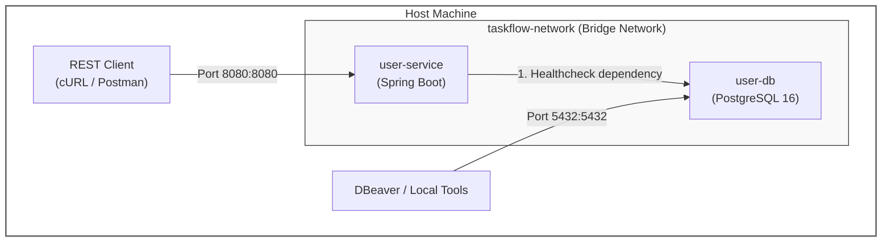

# docker-compose Walkthrough

This configuration orchestrates two isolated services on a local bridge network:

- `user-db`: A dedicated PostgreSQL 16 database running on Alpine Linux.

- `user-service`: A Spring Boot microservice containerized via multi-stage builds and tuned for containerized JRE memory management.



## Environment Configuration

Create a `.env` file in the same root directory as the `docker-compose.yml` file to keep secrets and system variables out of source control.

```bash
# Database Settings
DB_PORT_ENV=5432
DB_NAME_ENV=userdb
DB_USER_ENV=postgres
DB_PASSWORD_ENV=postgrespassword

# Security & Application Settings
JWT_SECRET_ENV=your-secure-production-secret-key-that-is-at-least-32-bytes-long
JWT_EXPIRATION_MS_ENV=3600000

# Optional Seed Admin Settings
ADMIN_USERNAME_ENV=admin01
ADMIN_PASSWORD_ENV=abcd1234
```

## `user-db` Service

1. image: postgres:16-alpine: Uses a lightweight Alpine Linux distribution of PostgreSQL 16 to minimize container memory footprint.

2. volumes: user_db_data:/var/lib/postgresql/data: Mounts a Docker named volume to the container’s internal data directory. This ensures database data persists across container restarts and rebuilds.

3. healthcheck: Executes `pg_isready` every 5 seconds. It tests whether PostgreSQL is ready to process SQL queries rather than just checking if the OS process has started.

## `user-service` Service

1. build & image: Compiles the source using the local Dockerfile and tags the generated image as `ensanguine/user-service:1.0.0`.

2. environment: Overrides `application.properties` default values dynamically at container runtime. Notice that `DB_HOST=user-db` uses the internal Docker DNS name of the database service instead of localhost.

3. depends_on.condition: The `depends_on` configuration with `condition: service_healthy` manages container startup ordering by making sure `user-service` stays paused until `user-db` is not just running, but fully initialized and ready to accept database queries.

    **Step-by-Step lifecycle flow**

    1. Service Spawn: Docker Compose starts the `user-db` container.   

    2. Healthcheck Loop: Docker Compose periodically executes the command specified in the `user-db.healthcheck` block inside the database container:

    ```bash
    test: ["CMD-SHELL", "pg_isready -U ${DB_USER_ENV} -d ${DB_NAME_ENV}"]
    interval: 5s
    timeout: 5s
    retries: 5
    ```

    It executes `pg_isready` every 5 seconds.   If PostgreSQL is still starting up or initializing its file system, `pg_isready` fails (returns exit code 1).

    3. Status Upgrade: Once PostgreSQL fully initializes and begins accepting socket connections, `pg_isready` returns exit code `0`. After passing the required healthcheck criteria, Docker assigns `user-db` the container status of healthy.   

    4. Unblocking Dependent Service: Docker Compose detects that the condition `service_healthy` has been met for `user-db`. It then boots up `user-service`.

## Networks & Volumes

- `users-network`: A custom isolated bridge network. Container-to-container traffic uses this private virtual network, isolated from host OS interference.

- `user_db_data`: Managed volume declared at the top level to store database tables and indexes on host disk independent of container lifecycles.

## Execution Workflow

### 1. Pre-flight Verification

Validate that Docker Compose parses variable substitutions and YAML formatting correctly without executing anything:

```bash
docker compose config
```

### 2. Build and Launch Containers

Rebuild the Spring Boot container image and launch all services in detached mode (`-d`):

```bash
docker compose up --build -d
```

### 3. Monitor Startup Sequence
Check service statuses to observe `user-db` transition from starting to healthy, followed by `user-service` booting up:

```bash
docker compose ps
```

### 4. Stream Application Logs
Follow real-time Spring Boot application logs to confirm proper initialization:

```bash
docker compose logs -f user-service
```
(Press `Ctrl + C` to stop following logs.)

### 5. Connect External Tools (DBeaver)

Connect your host machine's SQL clients to the exposed PostgreSQL port:

Host: localhost
Port: 5432
Database: `userdb` (or value of `${DB_NAME_ENV}`)
User/Password: Credentials declared in `.env`

### 6. Cleanup & Maintenance Operations

Standard Stop (Preserves Database Data):

```bash
docker compose down
```

Full Reset (Deletes Containers + Purges Database Volume):

```bash
docker compose down -v
```