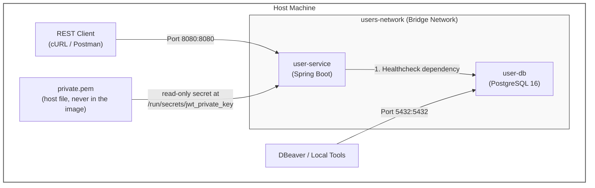

# docker-compose Walkthrough

This configuration orchestrates two isolated services on a local bridge network:

- `user-db`: A dedicated PostgreSQL 16 database running on Alpine Linux.

- `user-service`: A Spring Boot microservice containerized via multi-stage builds and tuned for containerized JRE memory management.



## Prerequisite: signing keys

`user-service` signs its JWTs with an RSA private key (RS256), so the key pair must exist before the first `docker compose up`. Create it once on the host, outside the project folder (full details in the main [README](README.md#signing-keys-rs256)):

```bash
mkdir -p ~/.taskflow/keys
openssl genpkey -algorithm RSA -pkeyopt rsa_keygen_bits:2048 -out ~/.taskflow/keys/private.pem
openssl rsa -pubout -in ~/.taskflow/keys/private.pem -out ~/.taskflow/keys/public.pem
chmod 600 ~/.taskflow/keys/private.pem
```

## Environment Configuration

Create a `.env` file in the same root directory as the `docker-compose.yml` file to keep secrets and system variables out of source control.

```bash
# Database Settings
DB_PORT_ENV=5432
DB_NAME_ENV=userdb
DB_USER_ENV=postgres
DB_PASSWORD_ENV=postgrespassword

# Application Settings
APP_PORT_ENV=8080

# Security Settings (RS256)
JWT_EXPIRATION_MS_ENV=3600000
# The task API must be configured with the same issuer and audience
JWT_ISSUER_ENV=user-service
JWT_AUDIENCE_ENV=taskflow-api

# Optional: host path of the private key (the compose file has its own default)
# JWT_PRIVATE_KEY_FILE=/home/you/.taskflow/keys/private.pem

# Optional: run the container as your host user so it can read the mounted key
# (find yours with `id -u` and `id -g`; both default to 1000)
# LOCAL_UID=1000
# LOCAL_GID=1000

# Optional Seed Admin Settings
ADMIN_USERNAME_ENV=admin01
ADMIN_PASSWORD_ENV=abcd1234
```

The private key itself never goes in `.env`. Only its host path can (`JWT_PRIVATE_KEY_FILE`). The old `JWT_SECRET_ENV` is no longer used and should be deleted.

## `user-db` Service

1. image: postgres:16-alpine: Uses a lightweight Alpine Linux distribution of PostgreSQL 16 to minimize container memory footprint.

2. volumes: user_db_data:/var/lib/postgresql/data: Mounts a Docker named volume to the container’s internal data directory. This ensures database data persists across container restarts and rebuilds.

3. healthcheck: Executes `pg_isready` every 5 seconds. It tests whether PostgreSQL is ready to process SQL queries rather than just checking if the OS process has started.

## `user-service` Service

1. build & image: Compiles the source using the local Dockerfile and tags the generated image as `ensanguine/user-service:1.0.0`.

2. environment: Overrides `application.properties` default values dynamically at container runtime. Notice that `DB_HOST=user-db` uses the internal Docker DNS name of the database service instead of localhost. The JWT settings work the same way: `JWT_ISSUER` and `JWT_AUDIENCE` are written into every token and checked when one is validated. `JWT_PRIVATE_KEY_PATH` is only a **path**, set to the fixed location inside the container where the secret is mounted. The key's contents are never an environment variable.

3. user: `"${LOCAL_UID:-1000}:${LOCAL_GID:-1000}"` runs the container as your host user's numeric ID, replacing the `spring` user from the Dockerfile. The mounted key keeps the owner and permissions of the host file, so a key with mode `600` owned by you can only be read by a process running as you. If your IDs are not 1000, set `LOCAL_UID` and `LOCAL_GID` in `.env`. The alternative is `chmod 644` on a dev-only key.

4. ports: `"${APP_PORT_ENV:-8080}:${APP_PORT_ENV:-8080}"` uses the same variable for the host and container side. The application listens on `APP_PORT`, so the two must agree, or the host port forwards to a port where nothing is listening.

5. secrets: `jwt_private_key` mounts the host key file read-only at `/run/secrets/jwt_private_key` inside this container, which is the path `JWT_PRIVATE_KEY_PATH` points to. The key never enters the image or the build context.

6. depends_on.condition: The `depends_on` configuration with `condition: service_healthy` manages container startup ordering by making sure `user-service` stays paused until `user-db` is not just running, but fully initialized and ready to accept database queries.

    **Step-by-Step lifecycle flow**

    1. Service Spawn: Docker Compose starts the `user-db` container.   

    2. Healthcheck Loop: Docker Compose periodically executes the command specified in the `user-db.healthcheck` block inside the database container:

    ```bash
    test: ["CMD-SHELL", "pg_isready -U ${DB_USER_ENV} -d ${DB_NAME_ENV}"]
    interval: 5s
    timeout: 5s
    retries: 5
    ```

    It executes `pg_isready` every 5 seconds.   If PostgreSQL is still starting up or initializing its file system, `pg_isready` fails (returns exit code 1).

    3. Status Upgrade: Once PostgreSQL fully initializes and begins accepting socket connections, `pg_isready` returns exit code `0`. After passing the required healthcheck criteria, Docker assigns `user-db` the container status of healthy.   

    4. Unblocking Dependent Service: Docker Compose detects that the condition `service_healthy` has been met for `user-db`. It then boots up `user-service`.

## Networks & Volumes

- `users-network`: A custom isolated bridge network. Container-to-container traffic uses this private virtual network, isolated from host OS interference.

- `user_db_data`: Managed volume declared at the top level to store database tables and indexes on host disk independent of container lifecycles.

## Secrets

`jwt_private_key` is declared at the top level of the compose file and read from the host:

```yaml
secrets:
  jwt_private_key:
    file: ${JWT_PRIVATE_KEY_FILE:-${HOME}/.taskflow/keys/private.pem}
```

There are two different paths, and they should not be confused:

| | Path | Used by |
|---|---|---|
| Host | `JWT_PRIVATE_KEY_FILE`, or the `${HOME}/...` default | Docker Compose, when it sets up the mount |
| Container | `/run/secrets/jwt_private_key` | The Java application, via `JWT_PRIVATE_KEY_PATH` |

- The `:-` means "use `JWT_PRIVATE_KEY_FILE` if it is set, otherwise the default after it".
- Compose does not expand `~`, which is why the default uses `${HOME}`.
- Only `user-service` lists the secret, so no other container can see the key.
- Run `docker compose config` to see the host path Compose resolved. If the file does not exist, `docker compose up` fails before any container starts.

## Execution Workflow

### 1. Pre-flight Verification

Check that the private key exists, then validate that Docker Compose parses variable substitutions and YAML formatting correctly without executing anything:

```bash
ls -l ~/.taskflow/keys/private.pem
docker compose config
```

In the `docker compose config` output, check that the `secrets` entry points at your key file and that `JWT_ISSUER`, `JWT_AUDIENCE` and the published ports are filled in.

### 2. Build and Launch Containers

Rebuild the Spring Boot container image and launch all services in detached mode (`-d`):

```bash
docker compose up --build -d
```

### 3. Monitor Startup Sequence
Check service statuses to observe `user-db` transition from starting to healthy, followed by `user-service` booting up:

```bash
docker compose ps
```

### 4. Stream Application Logs
Follow real-time Spring Boot application logs to confirm proper initialization:

```bash
docker compose logs -f user-service
```
(Press `Ctrl + C` to stop following logs.)

### 5. Connect External Tools (DBeaver)

Connect your host machine's SQL clients to the exposed PostgreSQL port:

Host: localhost
Port: 5432
Database: `userdb` (or value of `${DB_NAME_ENV}`)
User/Password: Credentials declared in `.env`

### 6. Smoke Test

Run this from the project root, on the host (it reads `.env` and your key files):

```bash
./smoke-test.sh --up --restart
```

It rebuilds the stack, logs in, checks the token (RS256, issuer, audience, roles, expiry), verifies the signature against `public.pem`, confirms that tampered, unsigned and HS256 tokens are rejected, checks the role rules, and finally restarts `user-service` to confirm earlier tokens still work. It exits non-zero if any check fails.

### 7. Cleanup & Maintenance Operations

Standard Stop (Preserves Database Data):

```bash
docker compose down
```

Full Reset (Deletes Containers + Purges Database Volume):

```bash
docker compose down -v
```

## Troubleshooting

| Symptom | Likely cause and fix |
|---|---|
| `Could not load private key ... AccessDeniedException` | The container user cannot read the mounted key. Run `chmod 644` on a dev-only key, or set `LOCAL_UID` and `LOCAL_GID` to your `id -u` and `id -g`. |
| `docker compose up` fails before starting, naming the secret file | The key does not exist at the host path. Run `docker compose config` to see the resolved path, then create the key or set `JWT_PRIVATE_KEY_FILE`. |
| `Could not load private key ... NoSuchFileException` | The secret is not mounted into the service, or `JWT_PRIVATE_KEY_PATH` is not `/run/secrets/jwt_private_key`. |
| No response on `localhost:8080` | `APP_PORT_ENV` is missing or inconsistent. Look for `Tomcat started on port ...` in `docker compose logs user-service`. |
| `Unable to determine Dialect without JDBC metadata` | The application cannot reach the database. Check that `user-db` is healthy and the `DB_*` values match. |
| Every token rejected with 401 after a change | The issuer or audience differs between this service and the one validating tokens. |
